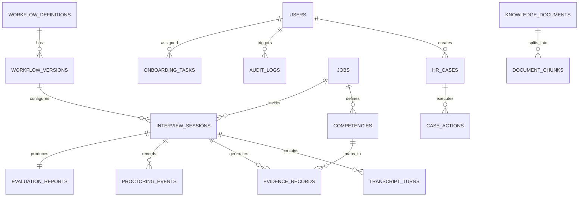

# EMPLOYEE360 AI — SYSTEM ARCHITECTURE & IMPLEMENTATION ROADMAP
**Project Title:** An Evidence-Driven Autonomous AI Framework for Intelligent Employee Lifecycle Management  
**Context:** Final-Year Engineering Capstone Project | Assigned by Zensar HR  
**Status:** Pre-Development & Architectural Design Phase  

---

## 1. Executive Summary & Vision

**Employee360 AI** is an enterprise-grade autonomous AI platform designed to automate and orchestrate three interconnected pillars of the corporate employee lifecycle:
1. **Hiring & Candidate Assessment:** Interactive voice-based AI interviews, dynamic resume claim verification ("Defend Your Resume"), evidence sufficiency mapping, and multi-modal proctoring integrity detection.
2. **Employee Onboarding:** Guided joining checklists, policy retrieval, credential/document collection, automated proactive task tracking, and action verification.
3. **Employee Assistance & HR Case Resolution:** Policy consultation via Grounded Retrieval-Augmented Generation (RAG), autonomous HR case resolution with authorized mock action execution, and policy escalation workflows.

### The Paradigm Shift: From Shallow Chatbot to Autonomous Agentic Core
Traditional HR bots are stateless, reactive text generators that answer FAQs without accountability. Employee360 AI replaces this with a **Deterministic 7-Step Operating Loop**:
$$\text{Understand} \longrightarrow \text{Plan} \longrightarrow \text{Gather Evidence} \longrightarrow \text{Check Policy} \longrightarrow \text{Act} \longrightarrow \text{Verify} \longrightarrow \text{Audit}$$

Every AI assertion and hiring recommendation is backed by a **Proof-Carrying Decision Chain**:
$$\text{Requirement} \longrightarrow \text{Evidence} \longrightarrow \text{Source/Transcript} \longrightarrow \text{Rule} \longrightarrow \text{Confidence} \longrightarrow \text{Human Review}$$

---

## 2. Constraints & Project Boundaries (Zensar Compliance)

| Constraint | Enforcement Mechanism |
| :--- | :--- |
| **English Language Only** | STT, prompts, and evaluation rubrics operate strictly in English. |
| **Synthetic Data & Zero Live Integrations** | No live hooks to Zensar Active Directory, Workday, or SAP. All HR actions interface with simulated mock services. |
| **No Telephony Integration** | WebRTC / WebSocket browser-based audio and video sessions only. |
| **PS1 Prioritized Before PS2** | Conversational core and evidence engine (PS1) are fully validated before proctoring algorithms (PS2) are engaged. |
| **Non-Punitive Anomaly Signals** | Detected proctoring signals are logged with confidence metrics and video/audio frame evidence as audit items; the AI never makes autonomous disqualification decisions. |
| **Cost & Open-Source Preference** | Local-first open-source models (`faster-whisper`, `pgvector`, local vision detectors) with pluggable adapters for cloud LLMs. |

---

## 3. Seven-Layer System Architecture

```mermaid
graph TD
    subgraph Layer 1: Client Web Interfaces
        UI_HR[HR Command Center & Config Studio]
        UI_CAND[Candidate Voice Interview Studio]
        UI_EMP[Employee Assistance & Onboarding Portal]
        UI_LAB[Adversarial Proctoring Lab]
    end

    subgraph Layer 2: API Gateway & Access Control
        GW[FastAPI Gateway]
        AUTH[RBAC Auth: JWT & Signed Invite Tokens]
        RATE[Rate Limiter & Session Manager]
    end

    subgraph Layer 3: Configuration & Compiler
        CFG_MGR[Workflow Configurator]
        COMPILER[HR Agent Compiler]
        RUBRIC[Competency & Rubric Manager]
    end

    subgraph Layer 4: Autonomous Agent Core
        ORCH[LangGraph / State Orchestrator]
        CONV[Conversation & Turn Engine]
        EVID[Evidence Sufficiency Engine]
        RAG[Grounded Knowledge / RAG Engine]
        ACT[Action Engine & State Verifier]
    end

    subgraph Layer 5: Proctoring & Signal Processing
        VISION[OpenCV & MediaPipe Face/Gaze Detector]
        AUDIO_SIG[Voice Activity & Diarization Detector]
        ANOMALY[Anomaly Classification & Evidence Logger]
    end

    subgraph Layer 6: Model & Service Adapters
        STT[STT: faster-whisper / Web Speech]
        LLM[LLM: Pluggable OpenAI/Gemini/Ollama]
        TTS[TTS: Kokoro / Edge-TTS / Web Speech]
        EMB[Embeddings: BAAI/bge-small-en-v1.5]
    end

    subgraph Layer 7: Persistence & Audit
        DB[(PostgreSQL + pgvector)]
        MEDIA_STORE[(Local Media / Snapshot Storage)]
        AUDIT[(Immutable Audit Event Log)]
    end

    Layer 1 --> Layer 2
    Layer 2 --> Layer 3
    Layer 2 --> Layer 4
    Layer 2 --> Layer 5
    Layer 4 --> Layer 6
    Layer 5 --> Layer 6
    Layer 4 --> Layer 7
    Layer 5 --> Layer 7
```

### Component Breakdown
1. **HR Agent Compiler:** Ingests declarative JSON/YAML workflow schemas, validates them against Pydantic models, and compiles them into a versioned state machine graph with explicit states, transitions, required fields, and tool permissions.
2. **Evidence Sufficiency Engine:** Compares candidate answers and extracted claims against defined competency rubrics. Calculates evidence coverage scores. When coverage is under threshold ($< 0.70$), dynamically generates targeted follow-up probes instead of advancing to next competency.
3. **Action Engine with Two-Phase Verification:**
   - Phase 1: Dispatches authorized mock action (e.g., `create_leave_request`, `upload_id_document`).
   - Phase 2: Queries the target mock state to verify state transition actually completed before reporting success to user.
4. **Proctoring Engine (PS2):** Samples video frames at 1–2 FPS over WebSocket to detect:
   - Multiple faces in frame / face absence (MediaPipe Face Mesh).
   - Gaze deviation / head pose extremes (PnP head pose estimation).
   - Audio anomalies (multiple speaker acoustic signatures).

---

## 4. Relational Database Schema Plan (PostgreSQL + pgvector)



### Core Entity Definitions
- **`users`**: `id (UUID)`, `email`, `hashed_password`, `role (HR_ADMIN, HR_REVIEWER, EMPLOYEE)`, `created_at`
- **`workflow_definitions`**: `id`, `name`, `type (HIRING, ONBOARDING, ASSISTANCE)`, `description`
- **`workflow_versions`**: `id`, `workflow_id`, `version_number`, `config_json`, `is_active`, `compiled_hash`
- **`jobs`**: `id`, `title`, `department`, `description`, `workflow_version_id`, `created_by`
- **`competencies`**: `id`, `job_id`, `name`, `description`, `evaluation_rubric_json`, `weight`
- **`interview_sessions`**: `id`, `job_id`, `candidate_name`, `candidate_email`, `invite_token_hash`, `status (PENDING, IN_PROGRESS, COMPLETED, ESCALATED)`, `started_at`, `ended_at`
- **`transcript_turns`**: `id`, `session_id`, `speaker (AI, CANDIDATE)`, `turn_index`, `text`, `audio_url`, `latency_ms`, `created_at`
- **`evidence_records`**: `id`, `session_id`, `competency_id`, `claim_statement`, `evidence_quote`, `confidence_score (0.00-1.00)`, `status (SUPPORTED, PARTIAL, INSUFFICIENT)`
- **`proctoring_events`**: `id`, `session_id`, `timestamp_offset_ms`, `anomaly_type (MULTIPLE_FACES, ABSENCE, GAZE_DEVIATION, SECOND_VOICE)`, `confidence`, `frame_snapshot_url`, `reviewed_status`
- **`evaluation_reports`**: `id`, `session_id`, `overall_score`, `competency_scores_json`, `sufficiency_summary`, `integrity_summary`, `recommendation_narrative`, `is_finalized`
- **`knowledge_documents`**: `id`, `title`, `category`, `source_filename`, `version`, `uploaded_at`
- **`document_chunks`**: `id`, `document_id`, `chunk_index`, `content`, `embedding (vector(384))`, `metadata_json`
- **`hr_cases`**: `id`, `employee_id`, `category`, `status (OPEN, IN_PROGRESS, RESOLVED, ESCALATED)`, `created_at`
- **`case_actions`**: `id`, `case_id`, `action_name`, `input_payload_json`, `execution_result_json`, `verified (BOOLEAN)`, `timestamp`
- **`onboarding_tasks`**: `id`, `employee_id`, `task_name`, `description`, `status (PENDING, SUBMITTED, VERIFIED)`, `due_date`
- **`audit_logs`**: `id`, `actor_type`, `actor_id`, `action_name`, `resource_type`, `resource_id`, `payload_before`, `payload_after`, `timestamp`

---

## 5. Technology Stack & Evaluation Matrix

| Subsystem | Primary Technology | Trade-Off & Evaluation Rationale |
| :--- | :--- | :--- |
| **Frontend UI** | **Next.js 14 (App Router) + React + TypeScript** | Full SSR/CSR flexibility, fast routing, enterprise component libraries, native Web Media APIs support. |
| **Backend API** | **FastAPI (Python 3.11+)** | High-performance asynchronous event loop, native WebSocket handling, automatic OpenAPI/Swagger documentation, seamless Python AI/ML ecosystem interop. |
| **Database** | **PostgreSQL 16 + pgvector** | Unified relational data + dense vector embeddings in one ACID-compliant engine. Eliminates synchronization bugs between SQL and external vector stores like Pinecone/FAISS. |
| **ORM & Migrations** | **SQLAlchemy 2.0 (Async) + Alembic** | Standard enterprise data layer, robust migration histories, strict typing. |
| **Speech-to-Text** | **faster-whisper (CTranslate2)** | 4x faster inference than OpenAI Whisper with 50% less VRAM usage; runs locally on CPU or low-end GPU without cloud API costs. |
| **Text-to-Speech** | **Kokoro-82M / Edge-TTS** | High naturalness, sub-200ms generation latency, open-source/free, lightweight. |
| **LLM Orchestration** | **LangGraph / Custom State Machine with LiteLLM** | Deterministic cyclical graph execution (looping through evidence collection); LiteLLM provides vendor-agnostic fallback (Gemini, Ollama Llama 3, OpenAI). |
| **Computer Vision** | **OpenCV + MediaPipe Face Mesh** | Lightweight, robust 468-point 3D facial landmarks, fast CPU inference, highly accurate gaze and pose estimation without heavy GPU dependency. |
| **Containerization** | **Local Native Execution (No-Docker)** | Runs directly via Python 3.12 `venv` and Node.js `npm run dev`. Eliminates container overhead during rapid development. |

---

## 6. End-to-End Implementation Roadmap (Phases 0–7)

### Phase 0: Discovery, Architecture Blueprint & Data Models (Current Step)
- [x] Analyze brief, Zensar constraints, and technical feasibility.
- [x] Produce architecture blueprint and DB schema specifications.
- [x] Create comprehensive technical documentation suite in `documents/`.
- [x] Generate self-contained `EMPLOYEE360_AI_MASTER_BLUEPRINT.pdf` for cross-team onboarding.
- [x] Set up project structure (`backend/`, `frontend/`, `documents/`, `tests/`) and `.env.example`.
- [x] Align with user on design choices and open questions.

### Phase 1: Application Foundation & Core Configuration Engine
- [x] Initialize Next.js 14 frontend and FastAPI backend with async SQLAlchemy 2.0 & Alembic.
- [x] Configure database layer (Local PostgreSQL with `pgvector` or zero-config SQLite with vector cosine search).
- [x] Implement RBAC Authentication (JWT Bearer for HR/Employees; HMAC cryptographic tokens for Candidates).
- [x] Build **Agent Configuration Studio**: CRUD for Workflow Definitions, Jobs, and Competencies.
- [x] Implement **HR Agent Compiler**: Pydantic schema validation and versioning for workflow configs.
- [x] Establish initial Seed Data generator (synthetic jobs, candidates, mock employees, knowledge base docs).

### Phase 2: First Working Hiring Interview (Voice & Conversation Engine)
- [ ] Candidate Interview Portal: Camera & Microphone hardware check, consent agreement screen.
- [ ] WebSocket streaming pipeline: bidirectional PCM/WAV audio streaming.
- [ ] STT Integration with `faster-whisper` and latency measurement.
- [ ] Contextual Turn Orchestrator: manages conversation history, system prompts, and next-question generation.
- [ ] Audio response streaming via low-latency TTS.
- [ ] Transcript persistence and session completion lifecycle.

### Phase 3: Agent Intelligence & Evidence Sufficiency Engine
- [ ] RAG Pipeline: Ingest HR policies and JDs, chunking, embedding generation, pgvector cosine search.
- [ ] "Defend Your Resume" parser: extract verifiable claims from candidate resume text.
- [ ] **Evidence Sufficiency Engine**: evaluates transcript responses against competency rubrics; dynamically injects follow-up probes for insufficient responses.
- [ ] **Proof-Carrying Decision Engine**: generates structured candidate assessment reports linking claims $\to$ transcript quotes $\to$ rubric $\to$ confidence.
- [ ] HR Reviewer Dashboard: interactive report viewer with evidence drill-downs.

### Phase 4: Interview Integrity & Proctoring (PS2)
- [ ] Media stream sampling: client sends 1 FPS canvas snapshot + continuous audio metrics.
- [ ] Visual anomaly detectors:
  - Face count detector (0 faces = candidate absence; >1 faces = third party present).
  - Head pose & gaze deviation estimator (MediaPipe).
- [ ] Audio anomaly detector: Voice Activity Detection (VAD) and secondary speaker acoustic energy detection.
- [ ] Proctoring Event Store: timestamped anomaly logs with frame snapshots and confidence metrics.
- [ ] **Adversarial Proctoring Lab**: UI to test detectors against synthetic attack scenarios (simulated absence, whispering, phone glances).

### Phase 5: Autonomous Workflows (Onboarding & Employee Assistance)
- [ ] Controlled Action Registry: interface for mock corporate actions (`submit_tax_form`, `request_leave`, `it_hardware_ticket`).
- [ ] Two-phase verification protocol: execute $\to$ query mock state $\to$ assert completion.
- [ ] Onboarding Portal: dynamic task checklist, policy Q&A, proactive reminder triggers.
- [ ] Employee Assistance Portal: conversational HR ticketing, policy RAG, autonomous resolution or tier-2 escalation.

### Phase 6: Research Evaluation, Fairness Lab & Benchmarking
- [ ] **Counterfactual Fairness Lab**: synthetic perturbations of candidate demographic indicators to audit evaluation stability.
- [ ] Latency & Performance benchmarks: STT latency, LLM time-to-first-token (TTFT), TTS latency, end-to-end conversation lag.
- [ ] Evidence sufficiency evaluation metrics: coverage rate, probe success rate.
- [ ] Proctoring accuracy matrix: True Positive, False Positive, and Latency per detector.

### Phase 7: Hardening, Polish & Demonstration
- [ ] Comprehensive Pytest suite and frontend component tests.
- [ ] Security audit: input sanitization, token expiration, secret management.
- [ ] Professional UI styling & executive dashboard metrics.
- [ ] Complete technical documentation, user guide, and demo seed scripts.

---

## 7. Definition of Done (DoD) for Phase 0 & Phase 1

### Phase 0: Definition of Done
1. Complete architectural specification document created and approved.
2. Verified alignment on all 9 Zensar project requirements.
3. Database ERD and API route structure finalized.
4. Repository root initialized with appropriate structure, `.env.example`, and `.gitignore`.
5. Full documentation folder (`documents/`) and Master Blueprint PDF generated.

### Phase 1: Definition of Done
1. Backend (`uvicorn backend.main:app --reload`) and frontend (`npm run dev`) boot cleanly with zero errors.
2. Database migrations run cleanly with Alembic; seed script populates synthetic roles, jobs, and workflows.
3. HR Admin can log in, view dashboard, and create a custom Job with Competencies.
4. Workflow Configurator allows saving and versioning an HR workflow schema; Compiler validates and compiles schema to JSON.
5. Secure candidate invite link generator produces HMAC signed tokens that authenticate a candidate session without a user account.
6. Test coverage $\ge 80\%$ on compiler and auth endpoints.

